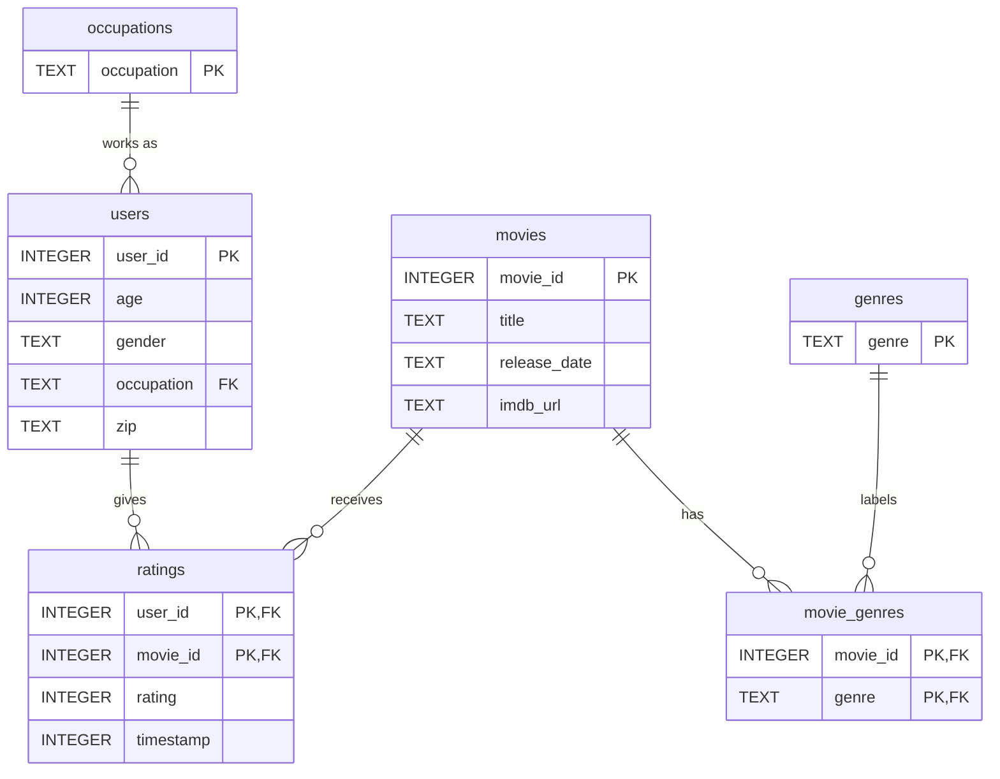

# DS5110 Homework 3: MovieLens 100K in SQLite

Team: A (Walid), B, C.

## How to run it

You need Python 3 with SQLite 3.37 or newer, because the tables use `STRICT` mode. Check with `python3 -c "import sqlite3; print(sqlite3.sqlite_version)"`.

```bash
make download   # download the data and unzip it into raw/
```

## Where the data comes from

- **Dataset:** MovieLens 100K by GroupLens Research: https://grouplens.org/datasets/movielens/100k/
- **File:** https://files.grouplens.org/datasets/movielens/ml-100k.zip
- **Downloaded:** 2026-10-26
- **MD5:** `0e33842e24a9c977be4e0107933c0723` (the same value GroupLens publishes next to the file)
- **SHA-256:** `50d2a982c66986937beb9ffb3aa76efe955bf3d5c6b761f4e3a7cd717c6a3229`

The dataset's terms don't allow sharing the data, so it isn't in this repo. `make download` gets it, and stops if the file doesn't match the MD5 above.

Citation: F. Maxwell Harper and Joseph A. Konstan. 2015. The MovieLens Datasets: History and Context. *ACM Transactions on Interactive Intelligent Systems* 5, 4, Article 19. https://doi.org/10.1145/2827872

## How the tables connect



PK is the column that identifies each row. FK is a column that points to a row in another table.

## Use of AI

- **Walid:** used Claude to draft the download script, the Makefile and this README, and to check the schema against the raw data. I reviewed every line.
- **Sandeep:** used Claude to draft the SQL queries, the pandas check, `src/describe.py` and the matching write-up sections, and to run them. The predicted row counts in the query files were written after the queries had run. I can explain every query.
- **Max** Gemini used to help brainstorm the date parsing in `load.py`, outline the CTE in Step 6, and draft the null check examples in Step 7. All scripts and queries were tested and verified locally.
