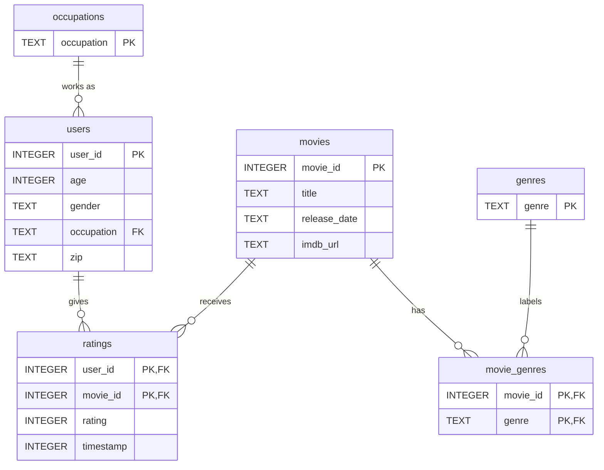

# DS5110 Homework 3: MovieLens 100K in SQLite

This project takes the MovieLens 100K movie ratings and puts them into a small SQLite database. The database has rules that check the promises the dataset's README makes, like "every rating is between 1 and 5". When a row breaks a rule, the database refuses it, and we save that row with the reason. Then we answer questions about the data in SQL.

Our answers to every step of the homework are in [`WRITEUP.md`](WRITEUP.md).

## What's in this repo

```
raw/                  the downloaded data; `make` fills it, and it is never committed or edited
sql/schema.sql        the database design: the tables, how they link, and the rules each row must follow
sql/queries/          one SQL question per file, each starting with our guess and the real row count
src/download.py       downloads the data, checks it's the right file, and unzips it into raw/
src/load.py           builds the database from raw/ and saves every refused row
src/run_queries.py    runs every query and prints its result and how many rows it returned
output/rejected.csv   every refused row, with SQLite's reason for refusing it
data/movielens.db     the database itself; `make` builds it, and it is never committed
figures/              the charts of the raw data from Step 0
Makefile              the commands below
```

## What you need

Python 3 with SQLite 3.37 or newer inside it, because our tables use `STRICT` mode (it makes SQLite refuse a value of the wrong type instead of quietly storing it). Check your version with:

```bash
python3 -c "import sqlite3; print(sqlite3.sqlite_version)"
```

Then install the two libraries we use:

```bash
python3 -m venv .venv
source .venv/bin/activate
pip install -r requirements.txt
```

## How to run it

```bash
make            # download the data if it isn't there yet, then build the database from scratch
make download   # only download the data and unzip it into raw/
make queries    # run every query in sql/queries/ and print the results
make clean      # delete the database and the refused-rows file, so the next `make` starts fresh
```

## Where the data comes from

- **Dataset:** MovieLens 100K, made by GroupLens Research at the University of Minnesota. Its page: https://grouplens.org/datasets/movielens/100k/
- **The file we download:** https://files.grouplens.org/datasets/movielens/ml-100k.zip (4,924,029 bytes)
- **Downloaded on:** 2026-10-26 (UTC)
- **MD5 checksum:** `0e33842e24a9c977be4e0107933c0723`. GroupLens publishes this same value next to the file, at the file's address + `.md5`.
- **SHA-256 checksum:** `50d2a982c66986937beb9ffb3aa76efe955bf3d5c6b761f4e3a7cd717c6a3229`

A checksum is a fingerprint of the file: if even one byte were different, the checksum would be different too. `src/download.py` stops with an error if the MD5 doesn't match, so everyone who runs `make` gets exactly the same files we used.

**Terms of use.** The README inside the zip says we may not share the data with others without permission. That's why the `raw/` folder is in `.gitignore` and the repo downloads the data instead of including it. The README also asks that we cite this paper: F. Maxwell Harper and Joseph A. Konstan. 2015. The MovieLens Datasets: History and Context. *ACM Transactions on Interactive Intelligent Systems* 5, 4, Article 19. https://doi.org/10.1145/2827872

## How the tables connect



How to read it: **PK** (primary key) is the column that identifies each row, so no two rows can share it. **FK** (foreign key) is a column that points to a row in another table, and the database refuses a value that points to nothing.

The three main files become three tables: `u.user` becomes `users`, `u.item` becomes `movies`, and `u.data` becomes `ratings`. The 19 yes/no genre columns in `u.item` become rows in `movie_genres`. The lists of genres and occupations become two small lookup tables. Why each rule is there is explained in [Step 2 of the write-up](WRITEUP.md#step-2--design-the-schema).

## Use of AI

- **Walid:** used Claude (Anthropic) to plan how we split the work, to draft `src/download.py`, the Makefile and this README, and to check the comments in the schema against the raw data. I reviewed every line and can explain each one.
