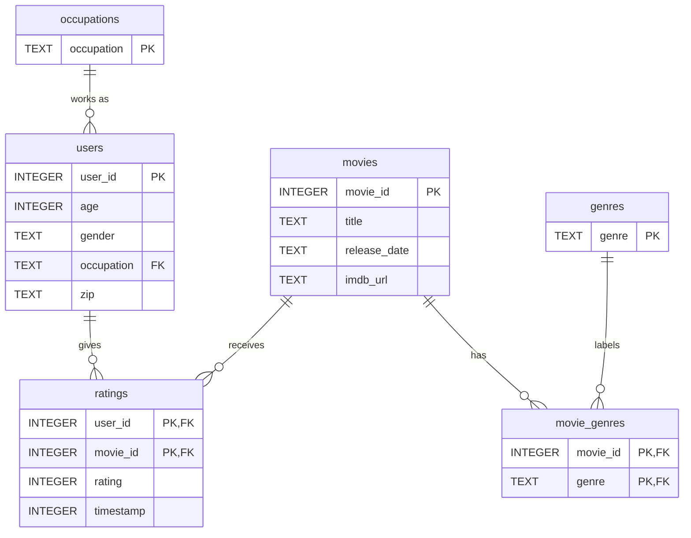

# DS5110 Homework 3: MovieLens 100K in SQLite

This repo downloads the MovieLens 100K files, loads them into a SQLite database whose schema enforces what the dataset's README claims, keeps every row the schema refuses, and answers questions about the data in SQL.

Answers to every step are in [`WRITEUP.md`](WRITEUP.md).

## Layout

```
raw/                  downloaded by `make`, never committed or edited
sql/schema.sql        the schema: every constraint is a claim about the data
sql/queries/          one query per file, each with its prediction and actual row count
src/download.py       downloads and checks the zip, unpacks it into raw/
src/load.py           builds data/movielens.db and records refused rows
src/run_queries.py    runs every query and prints its result and row count
output/rejected.csv   refused rows with SQLite's error message (generated)
data/movielens.db     the database (generated, not committed)
figures/              Step 0 charts of the raw data
Makefile
```

## Requirements

Python 3 whose built-in SQLite is 3.37 or newer, because the schema uses `STRICT` tables. Check with:

```bash
python3 -c "import sqlite3; print(sqlite3.sqlite_version)"
```

Then install the two libraries:

```bash
python3 -m venv .venv
source .venv/bin/activate
pip install -r requirements.txt
```

## Run it

```bash
make            # download the data if needed, rebuild data/movielens.db from scratch
make download   # only download and unpack the data into raw/
make queries    # run every query in sql/queries/ and print the results
make clean      # delete the generated database and rejected rows
```

## Data source

- **Dataset:** MovieLens 100K, GroupLens Research, University of Minnesota. Page: https://grouplens.org/datasets/movielens/100k/
- **File:** https://files.grouplens.org/datasets/movielens/ml-100k.zip (4,924,029 bytes)
- **Downloaded:** 2026-10-26 (UTC)
- **MD5:** `0e33842e24a9c977be4e0107933c0723`, the same value GroupLens publishes at the file URL + `.md5`
- **SHA-256:** `50d2a982c66986937beb9ffb3aa76efe955bf3d5c6b761f4e3a7cd717c6a3229`

`src/download.py` stops if the MD5 does not match, so anyone who runs `make` gets exactly these files.

**Terms of use.** The README in the zip says the data may not be redistributed without permission, which is why `raw/` is in `.gitignore` and the repo downloads it instead. Its required citation: F. Maxwell Harper and Joseph A. Konstan. 2015. The MovieLens Datasets: History and Context. *ACM Transactions on Interactive Intelligent Systems* 5, 4, Article 19. https://doi.org/10.1145/2827872

## Schema



`u.user`, `u.item` and `u.data` become `users`, `movies` and `ratings`. The 19 genre flags in `u.item` become rows of `movie_genres`, and `u.genre` and `u.occupation` become the two lookup tables. Why each constraint is there: [`WRITEUP.md`, Step 2](WRITEUP.md#step-2--design-the-schema).

## Use of AI

- **Walid:** used Claude (Anthropic) to plan the team split, draft `src/download.py`, the Makefile and this README, and to check the schema's comments against the raw data. I reviewed every line and can explain each one.
